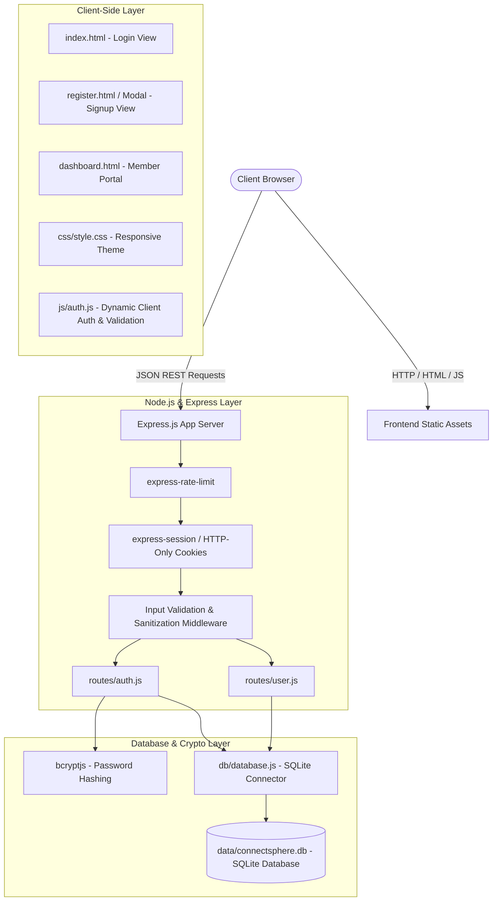

# PROJECT: ConnectSphere - Secure Social Media Authentication & User Portal Demo

## 1. Executive Summary
**ConnectSphere** is a clean, responsive, full-stack social media authentication and user portal demonstration built with HTML, CSS, JavaScript, Node.js, Express, and SQLite. 

Designed for learning modern web development and secure authentication principles, the application provides an authentic, high-quality social networking user experience using original branding ("ConnectSphere"). It showcases industry-standard security practices: salted bcrypt password hashing, parameterized SQL queries preventing SQL injection, rate-limiting against brute force, server-side validation and sanitization, and secure HTTP-only session state management.

---

## 2. Core Requirements & Goals
1. **Original Social Branding**: Distinct blue-and-white visual aesthetic ("ConnectSphere: Connect with friends and the world around you") without impersonating or infringing on real third-party services.
2. **Responsive Dual-Column UI**: Classic desktop two-column layout (branding & feature highlights on the left; clean elevated authentication card on the right) that transforms into a seamless single-column mobile view.
3. **Full Authentication Lifecycle**:
   - User Registration (Full Name, Username, Email, Password, Birth Date, Gender).
   - Real-time client-side feedback (password strength, format validation).
   - Secure Login with email or username.
   - Session-protected Member Dashboard (`/dashboard`) with profile summary, session diagnostics, and a mock social feed.
   - Secure Session Termination / Logout.
4. **Defensive Security Standard**:
   - Zero plaintext passwords stored (10 rounds bcrypt hashing).
   - Strict parameterized SQL prepared statements.
   - Server-side payload validation and email normalization.
   - Rate limiting on authentication routes (login/registration).
   - HTTP-only cookie-backed sessions with secure attributes.
5. **Clean Modular Architecture**: Separation of concerns between database layer, route handlers, middleware, and static frontend assets.

---

## 3. Architecture & Tech Stack

### Technology Selections
- **Runtime**: Node.js (v24.x)
- **Backend Framework**: Express.js (v4.x)
- **Database**: SQLite (`node:sqlite` native `DatabaseSync` engine - zero native compilation issues on Windows, ultra-fast, local file persistence)
- **Security & Crypto**: `bcryptjs` (reliable salted hash computation), `express-rate-limit` (brute force mitigation), `validator` (input sanitization)
- **Session Management**: `express-session` with secure cookies
- **Frontend**: Semantic HTML5, CSS3 with modern Flexbox/Grid, and modular vanilla JavaScript (fetch API, async/await)

---

## 4. Database Schema Specification

### `users` Table
| Column | Type | Constraints | Description |
|---|---|---|---|
| `id` | INTEGER | PRIMARY KEY AUTOINCREMENT | Unique user identifier |
| `first_name` | TEXT | NOT NULL | User's first name |
| `last_name` | TEXT | NOT NULL | User's last name |
| `username` | TEXT | UNIQUE NOT NULL | Normalized lowercase username |
| `email` | TEXT | UNIQUE NOT NULL | Normalized lowercase email address |
| `password_hash` | TEXT | NOT NULL | 60-character bcrypt hash |
| `date_of_birth` | TEXT | NULL | User's birthdate (YYYY-MM-DD) |
| `gender` | TEXT | NULL | Self-selected gender |
| `avatar_color` | TEXT | DEFAULT '#1877F2' | Dynamic profile badge color |
| `created_at` | DATETIME | DEFAULT CURRENT_TIMESTAMP | Account creation timestamp |
| `last_login_at` | DATETIME | NULL | Last successful authentication |

### `posts` Table (Demo Social Feed)
| Column | Type | Constraints | Description |
|---|---|---|---|
| `id` | INTEGER | PRIMARY KEY AUTOINCREMENT | Post identifier |
| `user_id` | INTEGER | NOT NULL, FOREIGN KEY (users.id) | Author user ID |
| `content` | TEXT | NOT NULL | Post text content |
| `created_at` | DATETIME | DEFAULT CURRENT_TIMESTAMP | Post creation timestamp |

---

## 5. Security & Verification Guarantees
- Passwords are encrypted before database insertion and never logged or exposed.
- Prepared SQL statements prevent SQL injection across all inputs.
- Rate limiting prevents credential stuffing (max 10 login attempts per 15 minutes per IP).
- Session cookies are signed, HTTP-only, and destroyed upon logout.
- Responsive design renders cleanly across desktop (1024px+), tablet (768px), and mobile (<480px).
