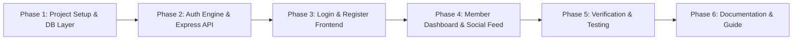

# ROADMAP: ConnectSphere Implementation

## Phase Overview

---

### Phase 1: Project Foundation & Database Architecture
- [x] Step 1.1: Initialize project dependencies (`express`, `bcryptjs`, `express-session`, `express-rate-limit`, `validator`).
- [x] Step 1.2: Implement SQLite database module (`src/db/database.js`) with schema creation, indexes, and parameterized query helpers.
- [x] Step 1.3: Create automated database seeding script (`src/db/seed.js`) providing demo accounts for immediate testing.

### Phase 2: Express Backend & Security Middleware
- [x] Step 2.1: Implement input validation and sanitization middleware (`src/middleware/validation.js`).
- [x] Step 2.2: Implement rate limiting middleware for auth endpoints (`src/middleware/rateLimiter.js`).
- [x] Step 2.3: Implement session management and route protection middleware (`src/middleware/auth.js`).
- [x] Step 2.4: Implement auth route handlers (`src/routes/auth.js`) for register, login, logout, and me.
- [x] Step 2.5: Implement social posts route handlers (`src/routes/posts.js`) for creating and reading feed posts.
- [x] Step 2.6: Configure Express server entrypoint (`src/server.js`) with static asset serving and security headers.

### Phase 3: Login & Registration Frontend UI
- [x] Step 3.1: Build `public/css/style.css` with responsive blue-and-white theme, clean typography, card shadows, animations, and modals.
- [x] Step 3.2: Build `public/index.html` featuring dual-column layout, login form, toggle password visibility, error alerts, and registration trigger.
- [x] Step 3.3: Build `public/register.html` (and registration modal) with inputs for name, username, email, password, birthdate, and gender.
- [x] Step 3.4: Build `public/js/auth.js` for asynchronous fetch requests, client-side validation, password strength indicator, and error notifications.

### Phase 4: Member Dashboard & Social Feed UI
- [x] Step 4.1: Build `public/dashboard.html` with navigation bar, user avatar, welcome banner, session info card, and feed stream.
- [x] Step 4.2: Build `public/js/dashboard.js` handling session checks, posting updates, rendering feed items, and logging out.

### Phase 5: Testing, Security Validation & Verification
- [x] Step 5.1: Verify registration workflow (valid data, duplicate email/username handling, password length enforcement).
- [x] Step 5.2: Verify bcrypt hash verification and database storage (ensure password is never stored in plaintext).
- [x] Step 5.3: Verify login authentication (correct credentials, incorrect credentials, session cookie issuance).
- [x] Step 5.4: Verify protected routes and session persistence (unauthenticated redirect vs authenticated access).
- [x] Step 5.5: Verify rate limiting and SQL injection protection against malicious payloads.

### Phase 6: Documentation & Delivery
- [x] Step 6.1: Create comprehensive `README.md` with features, architecture, installation, demo credentials, and security notes.
- [x] Step 6.2: Final review and handoff.
